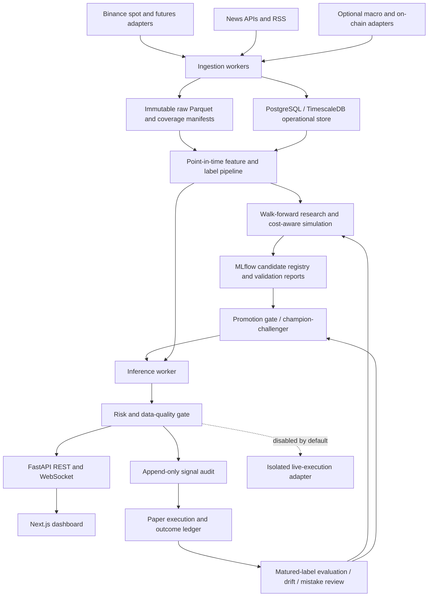

# Supertrader — architecture and research contract

Status: deliverable 1, architecture only. Prepared 8 October 2026. Target repository: D:/supertrader/. No model has been trained and no profitable strategy is claimed.

## Product decisions

Build a SOL/USDT research and signal platform with separate ingestion, research, inference, risk, outcome evaluation, and presentation services. Defaults: signals-only; spot market; no leverage; no exchange credentials needed for public data. Initial decision horizon: 4 hours using completed 1-hour bars, with completed 4-hour/daily context. Collect all requested timeframes for research. Higher-frequency signals are separate experiments rather than contradictory signals mixed into one score.

Spot SELL means reduce an existing long or recommend flat, never open a short. Futures uses a separate instrument identifier, simulator, funding accounting, and explicit configuration. HOLD means no position change; target exposure is returned separately. Without account equity and current exposure, suggested sizing is an illustrative equity fraction, not an executable quantity.

Confidence represents a calibrated, horizon-specific event probability under the documented labeling and cost assumptions. It is not the probability of guaranteed profit. If calibration or data is insufficient, confidence is null and status explains why. RL action logits and an arbitrary ensemble vote are not probabilities of price appreciation.

## Architecture



Separate processes prevent retraining or sentiment inference from blocking API responses. Redis carries notifications and short-lived caching, never the only copy of a signal. PostgreSQL persists job states and idempotency keys. Parquet remains the reproducible bulk research source. Docker Compose provides backend, ingestion worker, research worker, frontend, database, Redis, and MLflow; GPU training is an optional profile. Windows development instructions support native tools and Docker Desktop.

## Technology choices

| Component | Choice | Purpose |
|---|---|---|
| Market ingestion | Python, ccxt REST, native Binance WebSockets | Paginated history and exchange-specific sequence handling |
| Storage | Partitioned Parquet + PostgreSQL/TimescaleDB | Bulk replay, audits, live queries, outcomes |
| Schemas/config | Pydantic, YAML/environment configuration | Validated contracts; secrets outside code |
| Features | NumPy/pandas initially, optional Polars for bulk processing | Shared deterministic training/inference calculations |
| Baselines | Buy-and-hold, MA crossover, momentum, LightGBM | Prove value before complexity |
| Supervised sequence model | PyTorch TCN first; GRU/TFT experimental | Direction and return quantiles |
| Regime model | HMM fitted within each training fold | Causal filtered regime probabilities |
| RL | Gymnasium, Stable-Baselines3 PPO/SAC, sb3-contrib RecurrentPPO | Optional target-exposure policies |
| Explanations | SHAP for supported models + separate risk/ensemble reasons | Describe model influence without inventing causal evidence |
| Sentiment | Revision-pinned FinBERT behind a feature flag | Financial-language sentiment; validate on SOL news |
| API | FastAPI, asyncio WebSockets, authenticated mutation endpoints | Read endpoints, live push, paper controls |
| Frontend | Next.js App Router, TypeScript, Tailwind, Lightweight Charts | Responsive trading terminal with reconnect/stale states |
| Experiment tracking | MLflow + dataset/model/feature hashes | Reproducible comparison and rollback |
| Quality/operations | pytest, Ruff, mypy, frontend type checks, CI, structured logs | Leakage tests, integration tests, observable services |

Dependencies will be version-pinned and compatibility-tested during implementation. TradingView attribution will be included as required by its repository notice.

## Data correctness and availability

Every observation carries event_time, observed_at, available_at, source, instrument/market type, revision, and quality status. Candles also record open_time, close_time and whether they are final. Features at decision time t use only observations available by t. For audited historical archives, availability may be modeled as close/publication time plus documented latency; that assumption is recorded, not represented as proven historical receipt time.

News stores publication and first-observed times separately. Online availability is at least the first observed time, even when publication was earlier. Missing publication times are flagged; later edits are stored as new revisions. An article fetched today cannot be inserted retroactively into a historical simulation without a suitable point-in-time archive. Deduplication, novelty and credibility weights use only previously available information.

Download actual available SOL history from the earliest supported candle per market. One-minute candles are the canonical resampling source; directly downloaded higher-timeframe candles serve as consistency checks. UTC alignment, partial bars, paginated boundaries, duplicates and gaps receive explicit checks. Never fill an outage with fake tradable candles. Record unavailable windows and block decisions until configured recovery/warmup conditions pass.

L2 books require snapshot plus buffered sequenced deltas. Sequence gaps invalidate the book and trigger a new snapshot. Spot and futures streams remain separate. Funding and liquidation observations come from futures; open interest is polled through supported REST endpoints. Public liquidation streams are snapshots and can omit events: these features measure observed liquidation activity, not total liquidations. Reconnects cannot reconstruct missing historical L2/liquidation events unless an archive supports it.

Full historical OHLCV does not imply full historical news, order books, OI, or on-chain/macro observations. A coverage manifest drives two model families: long-history OHLCV models and shorter-history enriched models. Missing optional feeds never become fabricated neutral sentiment or zero liquidation totals; flags and model compatibility determine eligibility.

## Features, labels, and validation

Implement requested feature families in versioned groups: momentum, volatility, microstructure, statistics, regimes, and news. Expensive or fragile features such as Hurst, entropy, fractional differentiation and GARCH are experimental flags requiring ablation evidence. Fit model parameters, fractional-difference orders, scalers and HMMs on the training fold only. HMM inference uses filtered probabilities; whole-sequence smoothing leaks future observations. Multi-timeframe joins use only closed bars.

Triple-barrier labels record entry, vertical horizon and outcome end times. Signals calculated after a completed bar execute at the next available simulated opportunity with latency and cost assumptions, never at a retrospectively chosen close. If both stop and target are touched in one OHLC bar, use finer data or a declared conservative rule. Futures simulation includes funding, leverage/margin constraints and liquidation risk if leverage is enabled; spot cannot short.

Use chronological outer walk-forward evaluation, purging by actual overlapping label windows, an embargo, and inner chronological tuning/calibration. Stacking uses out-of-fold predictions. Quantile quality uses pinball loss and empirical coverage; probabilities use Brier score, log loss and reliability plots. Reserve a final untouched holdout before tuning. Once inspected, that interval is an audit result, not a reusable untouched test.

Report net CAGR, Sharpe, Sortino, Calmar, drawdown, exposure, turnover, profit factor, win rate, VaR/CVaR and regime-specific results. Document annualization for 24/7 crypto and compare matched market, horizon, costs and risk budgets. Include multiple seeds and confidence intervals, cost sensitivity, parameter sensitivity, May 2021 and November 2022 stress windows where coverage permits. Track the experiment count for Deflated Sharpe; report PBO only when enough comparable strategy configurations exist. Trade shuffling alone does not preserve dependence: include block-bootstrap/resampling stress tests and state assumptions.

No RL promotion unless it adds reproducible out-of-sample value over suitable baselines after costs. SAC uses continuous target exposure; PPO can use the same continuous action space for a fair comparison. RecurrentPPO is a separate experiment; stock Stable-Baselines3 SAC does not supply recurrent policies. RL may remain research-only if it fails the gate.

## Learning from mistakes

1. At prediction time, persist signal ID, model and dataset versions, features/availability, probabilities, return quantiles, proposed target exposure, stops/targets, risk decisions and reason codes.
2. After the prediction horizon or simulated trade resolves, append the matured outcome: price movement, barrier result, actual simulated fills, costs, funding where relevant, maximum favorable/adverse excursion and net PnL. Evaluate both traded and abstained predictions to avoid selection bias. Unresolved outcomes never become training targets.
3. Attribute failures to directional error, calibration error, regime mismatch, news mismatch, data quality, slippage/cost assumptions or execution bugs. A losing trade alone does not prove a bad prediction; noisy outcomes are expected.
4. Monitor rolling calibration, net performance, feature/prediction drift, and error patterns by regime. Statistical thresholds and minimum sample sizes are predeclared in configuration. Feature drift alone triggers investigation; it does not prove the model has become unprofitable.
5. Weekly, train a challenger using only matured past information. Compare it with the champion on forward validation and shadow paper trading. Promotion requires risk, calibration, performance and operational gates; otherwise retain the champion or abstain. Rollback uses compatible data/features and models, never a stale artifact blindly.
6. Maintain a dated incident/research ledger: hypothesis, reproduction, correction, test, evaluation impact, experiment ID, and status. Bug fixes get regression tests. User feedback is stored as feedback, not automatically treated as market truth or rewarded trading actions.

This is a measurable improvement process, not guaranteed continual improvement. The platform may discover that no model has reliable edge and output HOLD with an explicit explanation. The dashboard shows empirical error rates and learning history. This ledger belongs to the application; it does not automatically retrain the chat assistant or guarantee memory across unrelated chats.

## Risk, signals, and operations

Risk overrides inference. Enforce stale-data/spread/volatility gates, risk-per-trade caps, account exposure caps, UTC daily-loss rules, drawdown kill switch, ATR stops/targets and optional trailing stops. Volatility targeting is bounded; fractional Kelly is optional, shrunk for estimation uncertainty and disabled without adequate validated inputs. Gap risk means a stop does not guarantee the configured maximum loss.

The signal contract includes instrument, market, decision time, expiry, horizon, action, target exposure, account assumptions, probability definition, confidence/calibration status, expected return quantiles, regime, rationale, supported SHAP contributions, data health, model version and risk overrides. A blocked service emits HOLD with an explicit operational status; it does not display a stale BUY as live.

Expose /signal/latest, /signals/history, /features/importance, /backtest/results, /news/feed and /health, plus candle history, paper portfolio/trades, outcome feedback and WebSocket subscription endpoints. Separate process liveness from data readiness. WebSocket messages carry sequence IDs; reconnecting clients reload canonical REST state. Protect paper mutation/config endpoints, restrict CORS, validate input, redact secrets, and include retention/backup policies.

Frontend shows candles, signal markers, exposure, stops/targets, regime context, explanations, news, backtests, paper PnL and model health. Display missing sentiment, unavailable SHAP, stale data and unvalidated models honestly. Show a prominent financial-advice disclaimer and TradingView attribution. Charts never substitute demo data for actual history without a visible demo label.

Live execution remains isolated and disabled. It requires explicit configuration, separate credentials, reconciliation, idempotent order IDs, size caps and kill switch. Implementation/testing proceeds without sending real orders; activating real trading requires explicit user authorization.

## Repository and staged acceptance

```text
backend/
  data/ features/ labels/ models/ rl/ backtest/
  risk/ signals/ outcomes/ monitoring/ api/ workers/
frontend/
infra/
configs/
docs/
notebooks/
tests/unit/ tests/integration/ tests/leakage/
```

| Step | Deliverable and acceptance |
|---|---|
| 1 | Architecture, assumptions, limitations, feedback design; no training claims |
| 2 | Resumable historical CLI, Parquet manifests, live adapters; pagination, gap, duplicate, sequence and reconnect tests |
| 3 | Causal features and triple-barrier labels; future-perturbation, fold-fit and timestamp-availability tests |
| 4 | Cost-aware baselines and simulator; hand-calculated fills/PnL, stop ambiguity and cost accounting tests |
| 5 | Supervised training and gated RL experiments; environment checks, chronological evaluation, reproducibility and seed reports |
| 6 | Calibration and ensemble; out-of-fold stacking, abstention and calibration reports |
| 7 | FastAPI, workers, audit/outcome ledger, registry and promotion controls; offline integration tests |
| 8 | Next.js terminal; type checks, responsive review, loading/error/stale/reconnect states and accessible controls |
| 9 | Docker Compose, CI and setup guide; startup/health checks and documented optional prerequisites |

Each step ends with files changed, checks run, actual results, limitations, and a wait for the user's “continue,” as requested in the supplied prompt. Large-history downloads, GPU runs, optional credentials and paid archives are explicit dependencies; absent prerequisites are reported rather than simulated as completed work.

## Primary references checked

- Binance spot streams and book synchronization: https://github.com/binance/binance-spot-api-docs/blob/master/web-socket-streams.md
- Binance futures market REST APIs, including open interest: https://developers.binance.info/en/docs/catalog/core-trading-derivatives-trading-usd-s-m-futures/api/rest-api/market-data
- Binance futures liquidation snapshot coverage: https://developers.binance.info/docs/derivatives/usds-margined-futures/websocket-market-streams/All-Market-Mini-Tickers-Stream
- Stable-Baselines3 SAC supported action spaces and recurrent limitation: https://stable-baselines3.readthedocs.io/en/master/modules/sac.html
- TradingView Lightweight Charts notice and attribution: https://github.com/tradingview/lightweight-charts
- FinBERT model card: https://huggingface.co/ProsusAI/finbert
